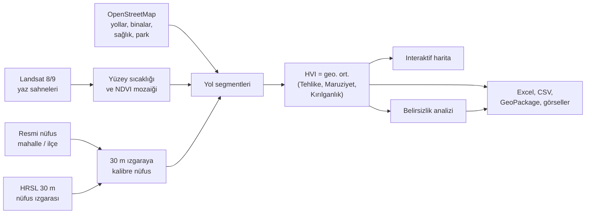

<div align="center">

# Türkiye Kentsel Isı Riski

**Hangi sokak sıcak havada önce ilgilenilmeyi hak ediyor?**
Uydu, OpenStreetMap ve resmi nüfus verisinden sokak ölçeğinde, açıklanabilir
bir Isı Hassasiyet Endeksi (HVI). Açık veri, açık kod, tek komutla yeniden üretilebilir.

[](https://github.com/Ayberkrk/turkiye-heat-risk/actions/workflows/tests.yml)
[](LICENSE)
[](https://opendatacommons.org/licenses/odbl/1-0/)
[](https://github.com/Ayberkrk/turkiye-heat-risk/releases)
[](https://doi.org/10.5281/zenodo.24028997)
[](https://github.com/Ayberkrk/turkiye-heat-risk/labels/good%20first%20issue)

[**Canlı harita**](https://ayberkrk.github.io/turkiye-heat-risk/) ·
[**Veri indir**](#veri-indir) ·
[**Hızlı başlangıç**](#hızlı-başlangıç) ·
[**Yöntem**](#metodoloji) ·
[**Atıf**](#atıf) ·
[English](README.en.md)

</div>


Her yol segmenti 0-100 arası bir puan alır. Puan üç sorunun cevabını birleştirir:
**burası sıcak mı** (Landsat yaz yüzey sıcaklığı), **burada çok insan var mı**
(30 m nüfus ızgarası ve bina yoğunluğu), **buradaki insanlar kırılgan mı** (yaşlı
ve çocuk oranı, ilçenin gelişmişliği, ağaç azlığı, sağlık tesisine ve parka
uzaklık). Üç grup birbirini telafi edemez: sıcak olmayan ya da kimsenin yaşamadığı
bir yolda risk düşük kalır. Haritada bir yola tıklayınca puanın nedenini görürsünüz.

> **Önemli:** Bu bir önceliklendirme aracıdır, sağlık verisiyle (acil başvuru,
> ölüm) doğrulanmamıştır. "Nereye önce bakmalı?" sorusuna cevap verir; bir yolun
> ötekinden kaç kat tehlikeli olduğunu ölçmez. Ayrıntı:
> [Bilinen sınırlamalar](#bilinen-sınırlamalar).

## Kim için, ne alırsınız?

| Siz | İşinize yarayacak olan | Nereden |
|---|---|---|
| **Belediye, planlamacı, STK** | Mahalle sıralaması, en riskli 1000 sokak listesi, rapora konabilir görseller, yazdırılabilir özet | Şehrin **Excel** dosyası ve **özet raporu** ([Veri indir](#veri-indir)) |
| **CBS kullanıcısı** | Tüm yollar ve mahalle poligonları, bileşen sütunlarıyla | **GeoPackage** (QGIS, ArcGIS, NetCAD tek dosya olarak açar) |
| **Gazeteci** | "En riskli mahalleler hangileri, neden?" sorusunun tablosu ve grafiği | Excel'in "Mahalleler" sayfası, `en_riskli_mahalleler.png` |
| **Araştırmacı** | Yol düzeyi tüm bileşenler, belirsizlik aralıkları, tüm şehirler tek tabloda, tekrar üretilebilir manifest | **CSV** + `manifest.json`, `docs/veri/turkiye_mahalleler.csv`, [örnek defter](examples/hizli_baslangic.ipynb) [](https://colab.research.google.com/github/Ayberkrk/turkiye-heat-risk/blob/main/examples/hizli_baslangic.ipynb) |
| **Geliştirici, katkıcı** | Şehirden bağımsız Python hattı, 550+ test, yeni şehir eklemek için şablon | [Hızlı başlangıç](#hızlı-başlangıç), [CONTRIBUTING.md](CONTRIBUTING.md) |

## Veri indir

Her şehrin sayfasında (canlı haritanın göstergesindeki **Verileri indir**
bağlantısı ya da [şehirler sayfası](https://ayberkrk.github.io/turkiye-heat-risk/))
şu dosyalar var:

| Dosya | İçerik |
|---|---|
| `<şehir>_isi_riski.xlsx` | Özet, Mahalleler, İlçeler, Öncelikli yollar, Sütun sözlüğü, Kaynaklar ve lisans sayfaları |
| `<şehir>_mahalleler.csv`, `<şehir>_ilceler.csv`, `<şehir>_oncelikli_yollar.csv` | Aynı tablolar, kod ve istatistik yazılımı için (UTF-8, virgül ayraçlı) |
| `ozet.html` | Tek sayfalık, yazdırılabilir şehir özeti: bulgular, en riskli mahalleler, görseller, atıf |
| `harita.png`, `en_riskli_mahalleler.png`, `risk_kaynagi.png`, `kategori_dagilimi.png` | Rapora ya da sunuma doğrudan konabilir görseller |
| `<şehir>_veri_paketi.zip` ([Releases](https://github.com/Ayberkrk/turkiye-heat-risk/releases/latest)) | Hepsi + tüm yollar (CSV ve GeoPackage), mahalle poligonları, sütun sözlüğü, manifest |

**Tüm şehirler tek tabloda:** [`docs/veri/`](docs/veri/) altında
`turkiye_mahalleler.csv`, `turkiye_sehirler.csv` ve `turkiye_isi_riski.xlsx`
(`python build_turkey_table.py` üretir). HVI ve kategoriler şehir içi görelidir;
şehirler arasında yalnızca mutlak sütunlar (yüzey sıcaklığı °C, NDVI, kişi/km²,
yaş oranları, mesafeler) karşılaştırılmalıdır.

Her sütunun anlamı ve birimi paketteki `sutun_sozlugu.csv` dosyasında ve Excel'in
"Sütun sözlüğü" sayfasında. Paket yerelde de üretilir:
`python pipeline.py ...` son adımda yazar, `python export_city.py --city <şehir>`
yalnızca paketi tazeler.

**Lisans:** yol geometrileri ve OSM'den türetilen öznitelikler OpenStreetMap
verisinin türevi olduğu için veri paketi **ODbL 1.0** altındadır; atıf:
"© OpenStreetMap katkıcıları". Nüfus ızgarası Meta & CIESIN HRSL (CC BY 4.0),
Landsat USGS (kamu malı). Kod MIT.

## Hızlı başlangıç

```bash
git clone https://github.com/Ayberkrk/turkiye-heat-risk.git
cd turkiye-heat-risk
python3.12 -m venv .venv && source .venv/bin/activate
pip install -r requirements.txt -c constraints.txt
python tools/run_demo.py --open      # 10 saniye, internetsiz: küçük örnek şehir
python pipeline.py --city izmir --years 2020 2026 --main-year 2026 --open
```

İlk komut, gerçek İzmir verisinden kesilmiş ~1,7 km'lik bir örnek şehri
(`tests/fixtures/ornek`) ağ bağlantısı olmadan baştan sona çalıştırır; kurulumun
doğru olduğunu görmenin en hızlı yolu. İkinci komut uydu sahnelerini seçer, yalnızca şehrin penceresini okur (tam sahne
indirmez), endeksi hesaplar, haritayı açar, belirsizlik analizini koşar ve veri
paketini `output/izmir/` altına yazar. 70 şehrin kimliği `src/cities/` altında;
yeni şehir eklemek `src/core/` içinde hiçbir dosyayı değiştirmeden mümkündür
([CONTRIBUTING.md](CONTRIBUTING.md)). Ayrıntılı kurulum ve Docker:
[Kurulum ve çalıştırma](#kurulum-ve-çalıştırma).

## Nasıl çalışır?



## Atıf

Bu hattı ya da veri paketini kullanıyorsanız [CITATION.cff](CITATION.cff)
dosyasındaki bilgiyle atıf verin (GitHub'ın sağ panelindeki **Cite this
repository** düğmesi biçimlendirilmiş hâlini verir). Sürüm geçmişi:
[CHANGELOG.md](CHANGELOG.md).

## İçindekiler

- [Ne yapıyor?](#ne-yapıyor)
- [Başka bir şehre/bölgeye uyarlama](#başka-bir-şehrebölgeye-uyarlama)
- [Metodoloji](#metodoloji)
- [Çok yıllı duyarlılık ve müdahale analizi](#çok-yıllı-duyarlılık-ve-müdahale-analizi)
- [Belirsizlik ve duyarlılık analizi](#belirsizlik-ve-duyarlılık-analizi)
- [Doğrulama ve ek duyarlılık kontrolleri](#doğrulama-ve-ek-duyarlılık-kontrolleri)
- [2020 → 2026: Bulgular](#2020--2026-bulgular)
- [Kurulum ve çalıştırma](#kurulum-ve-çalıştırma)
- [Proje yapısı](#proje-yapısı)
- [Bilinen sınırlamalar](#bilinen-sınırlamalar)

## Ne yapıyor?

1. **Uydu verisi**: Landsat 8/9 (Microsoft Planetary Computer) üzerinden şehri
   kaplayan en az bulutlu yaz sahnelerini seçer ve her bandın yalnızca şehir
   penceresini okur (Cloud Optimized GeoTIFF; İzmir'de bir termal bant için
   86 MB yerine 3 MB, pikseller tam sahnedeki aynı pencereyle birebir aynı).
2. **Yüzey sıcaklığı (LST) ve NDVI**: termal banttan yüzey sıcaklığını (°C),
   kırmızı/yakın kızılötesi banttan bitki örtüsünü hesaplar; karo başına üç
   sahnenin medyanını alıp kesintisiz bir mozaikte birleştirir.
3. **Yol ağı ve sıcaklık eşlemesi**: OpenStreetMap'ten çekilen her yol
   segmentine 10 m tampondaki ortalama LST'yi atar.
4. **Nüfus**: resmi mahalle/ilçe nüfusunu 30 m HRSL ızgarasına kalibre edip
   her yolun 150 m çevresindeki yoğunluğu ölçer.
5. **Isı Hassasiyet Endeksi (HVI)**: dokuz bileşeni Tehlike, Maruziyet ve
   Kırılganlık gruplarında toplayıp 0-100 skora çevirir. Her bileşenin ve
   grubun değeri ayrıca saklanır; skor onu oluşturan etkenlerle birlikte görünür.
6. **İnteraktif harita**: kategori katmanları, yıl seçici, her yolda puanın
   nedenini gösteren açıklama; tek dosyalık çevrimdışı sürüm ve GitHub Pages sürümü.
7. **Belirsizlik analizi**: ölçekleme, ağırlık ve birleştirme kararlarını 500
   kez rastgele değiştirip her yolun ve mahallenin "en riskliler arasında kalma
   olasılığını" hesaplar.
8. **Veri paketi**: Excel, CSV, GeoPackage, görseller ve yazdırılabilir özet.
9. **Çok yıllı analiz paketi (isteğe bağlı)**: üç veya daha fazla yılı
   ERA5-Land hava anomalisiyle karşılaştırır; ağaçlandırma ve gölgeleme what-if
   senaryolarını ayrı bir haritada gösterir.

## Başka bir şehre/bölgeye uyarlama

Proje artık şehir bazlı bir mimariye sahip: `src/core/` altındaki kod
tamamen şehirden bağımsızdır, İzmir'e özel her şey
`src/cities/izmir/config.yaml` ve `src/cities/izmir/adapter.py` içinde
izole edilmiştir. Yeni bir şehir eklemek `src/core/` içindeki
sabitleri değiştirmeyi **gerektirmez** - adım adım süreç için
[CONTRIBUTING.md](CONTRIBUTING.md)'ye bakın. Özetle:

**1. `src/cities/<sehir>/config.yaml` oluştur**
`bbox` (derece cinsinden [batı, güney, doğu, kuzey]), hedef UTM `crs`'i,
OSM `.osm.pbf` özüt URL'i ([openstreetmap.fr](https://download.openstreetmap.fr/extracts/)
veya [Geofabrik](https://download.geofabrik.de/)), `admin_level_ilce` /
`admin_level_mahalle` (bu etiket ülkeden ülkeye değişir - kendi bölgende
`osm_gdf['admin_level'].unique()` ile önceden doğrula) buraya yazılır.

**2. Bir demografi "adapter"ı yaz (en fazla emek isteyen adım)**
İki referans örnek farklı veri kaynağı senaryolarını gösterir:
  - `src/cities/izmir/adapter.py`: belediyenin kendi CKAN tabanlı açık veri
    portalı varsa (`acikveri.bizizmir.com`), mahalle seviyesinde nüfus/yaş.
  - `src/cities/eskisehir/adapter.py`: böyle bir portal YOKSA, TÜİK'in
    herkese açık ilçe seviyesindeki ADNKS yayınlarını statik CSV olarak
    kullanan şablon - kendi CKAN'ı olmayan başka bir Türkiye şehri için
    neredeyse değişiklik yapmadan uyarlanabilir. Ortak mantık
    `src/core/ilce_table_adapter.py`'de. Yeni şehir eklerken aynı yıl için
    ilçe düzeyinde 0-14, 15-64 ve 65+ sayımlarını doğrula; il oranlarını
    ilçe satırına yedek olarak yazma. Depodaki bazı eski şehir kayıtlarında
    il oranı kullanımı vardır; bunlar kayıt sayfasında ayrıca işaretlenmiştir.
    `tools/fit_city_bbox.py` bbox'ı yoğun mahalle kümesinden çizer ve gerçek
    OSM ile HVI kapsamını ölçer (eşik %60, bkz. `validate_city.py
    --osm-coverage`). Merkez ilçe OSM'de "<İl> Merkez", CSV'de "Merkez"
    (ya da tersi) yazılmış olabilir; `core/ilce_table_adapter.py` bunu eşler.

Her iki örnek de `fetch_population_data()` / `build_neighborhood_layer()`
arayüzünü uygular. Yeni bir şehir için aynı arayüzü uygulayan kendi
adapter'ını `src/cities/<sehir>/adapter.py` altında yaz:
  - Mahalle/idari sınır poligonlarını OSM'den çekmeye devam edebilirsin.
  - Nüfus yoğunluğu, yaşlı ve çocuk nüfus oranı verisini yerel istatistik
    kurumundan (TÜİK, Eurostat, US Census vb.) veya belediyenin kendi açık
    veri portalından CSV/JSON olarak al.
  - Mahalle-ilçe eşlemesi her iki adapter'da da **isme göre değil konumsal
    sorguyla** (`sjoin`, centroid içinde mi) yapılıyor - aynı isimli
    mahallelerin yanlış ilçeyle eşleşmesini önlüyor. Bu yaklaşımı koru,
    hangi ülkede olursan ol işe yarar.

**3. Doğrula ve çalıştır**
```bash
python validate_city.py <sehir>
python pipeline.py --city <sehir> --years <yıllar>
```
`validate_city.py`, config.yaml'ın gerekli alanları içerdiğini, bbox'ın
geçerli olduğunu, `crs`'in metre cinsinden ve bbox merkezinin UTM dilimiyle
uyumlu olduğunu, adapter'ın import edilebildiğini ve veri kaynağı
URL'lerinin erişilebilir olduğunu indirmeden önce kontrol eder.
Kaynak URL'lerine erişilemeyen ortamlarda `--offline` ile yalnızca yerel
config/adapter denetimini yapabilir; mevcut bir OSM özütünü ağ isteği olmadan
ölçmek için `python validate_city.py <şehir> --offline --osm-coverage`
kullanabilirsin. CKAN adapter'ları bunun için `load_cached_population_data`
kancasını sağlar; gerekli önbellek dosyaları yoksa komut ağ bağlantısı
denemeden açık hata verir. `--min-coverage` eşiği 0 ile 1 arasında olmalıdır.

OSM URL'i güncel bir PBF özütüne (ör. `*-latest.osm.pbf`) işaret edebilir;
normal çalıştırma daha önce indirilen özütü yeniden kullanır. Kaynağı yenileyip
yol/HVI katmanlarını yeniden hesaplamak için `pipeline.py` komutuna
`--refresh-osm` ekle. Yeni dosya indirme tamamlanınca mevcut özütün yerini alır.
CKAN gibi önbelleğe alınan demografi verisini yenilemek için `--refresh-population`
kullan; bu seçenek `refresh_population_data(config)` kancasını sağlayan
adapter'larda etkilidir (İzmir bunu destekler). Depodaki sabit CSV kullanan
adapter'lar yerel tabloları kullanmaya devam eder.

70 şehrin tamamının haritası, özet raporu ve indirilebilir tabloları sitede
yayında; Türkiye geneli tablolar `docs/veri/` altında. Tüm şehir config'lerini ve depoya
ekli nüfus/SEGE tablolarının yapısını ağ isteği yapmadan denetlemek için:

```bash
python validate_city_data.py --all
python validate_city_data.py izmir --json
```

Rapor; yapılandırma/adapter/tablo bütünlüğünü, Pages haritasının güncel,
sürüm bilgisi olmayan veya henüz yayınlanmamış oluşunu ayrı ayrı gösterir.
Bu offline denetim kaynak değerlerini asıl TÜİK/belediye/SEGE yayınıyla
karşılaştırmaz ve OSM kapsamını ölçmez; rapor bu iki durumu açıkça
"doğrulanmadı/ölçülmedi" olarak tutar. Gerçek yol kapsamı için
`validate_city.py <şehir> --osm-coverage` ve yerel OSM özütü gerekir.

**4. HVI bileşenlerini değiştir**
`src/core/hvi.py` içindeki `COMPONENT_GROUPS` hangi bileşenin hangi gruba
(tehlike, maruziyet, kırılganlık) girdiğini tanımlar. Yeni bir bileşen
eklemek için sütununu `robust_normalize_0_1` ile üret, ilgili gruba ekle ve
`HVI_FORMULA_VERSION`'ı artır.

## Metodoloji

### Yüzey sıcaklığı (LST)

Landsat Collection 2 Level-2 ürünleri, termal bandı laboratuvarda zaten
Kelvin cinsinden yüzey sıcaklığına kalibre eder. Tek gereken ölçek dönüşümü:

```
LST(K) = piksel_değeri × 0.00341802 + 149.0
LST(°C) = LST(K) - 273.15
```

Sahneler varsayılan olarak 1 Temmuz - 31 Ağustos arasında aranır. Sıcak
sezon şehirden şehre değiştiği için pencere `config.yaml`'ın `landsat`
bölümünden ayarlanabilir (`season_start: "06-15"`, `season_end: "09-15"`).
Yıllar arası karşılaştırmada aynı pencere kullanılmalıdır; pencereyi
değiştirdikten sonra `--force` ile sahneleri yeniden seçtirin.

**Termal bandın gerçek çözünürlüğü 100 m'dir.** Landsat 8/9 TIRS algılayıcısı
yüzey sıcaklığını yaklaşık 100 m'de ölçer; USGS ürünü 30 m ızgaraya yeniden
örnekler. Bu yüzden haritadaki sıcaklık yol segmenti başına raporlansa da
birbirine 100 m'den yakın sokaklar büyük ölçüde aynı ölçümü paylaşır:
harita mahalle içi sıcak bölgeleri ayırt eder, tek tek komşu sokakları
değil. NDVI (30 m) bu sınırlamayı taşımaz.

Bulutlar kızılötesiyi bozduğu için her sahne aranırken bulut oranı %30'un
altında tutulur ve her uydu karosu (path/row) için mevcut en temiz
`max_scenes_per_tile` (varsayılan 3, `config.yaml`'ın `landsat` bölümünden
ayarlanır) kadar tarih seçilir.

Sahne düzeyindeki düşük bulut oranı tek başına yeterli değil: toplam bulut
oranı düşük bir sahnede bile bulutun küçük bir kısmı doğrudan çalışma
alanının üzerine düşebilir. Bu yüzden `QA_PIXEL` bandı da indirilip LST ve
NDVI hesaplanmadan önce, sahnenin kendi piksel ızgarasında (mozaikleme ve
yeniden izdüşürmeden önce) piksel düzeyinde bir bulut maskesi uygulanır:
fill, dilated cloud, cirrus, cloud, cloud shadow ve snow bayraklarından
herhangi biri taşıyan pikseller `NaN`/nodata yapılır (`core/raster.py`,
`qa_invalid_mask`).

**Çoklu sahne kompoziti:** tek bir sahne seçmek yerine, her karo için
seçilen `max_scenes_per_tile` kadar sahnenin LST/NDVI'si ayrı ayrı
hesaplanıp (QA maskesi her biri kendi ızgarasında uygulanmış olarak) piksel
bazlı **medyanı** alınır (`core/raster.py`, `composite_scene_arrays`).
Aynı karonun farklı tarihli sahneleri aynı piksel ızgarasında gelmediği
için (başlangıç noktası yüzlerce metre kayabilir) sahneler önce karonun
ortak ızgarasına oturtulur (`tile_grid`), sonra medyanı alınır.
Medyan, ortalamadan daha dayanıklıdır - aykırı tek bir bulutlu/anormal
günün sonucu domine etmesini engeller. Bu, aşağıdaki "Metodolojik uyarı"da
bahsedilen tek-sahne kaynaklı gürültüyü azaltır (aynı yaklaşım, gece ısı
adası katmanı için `core/night_lst.py`'de zaten kullanılıyordu).
`max_scenes_per_tile: 1` ile eski tek-sahne davranışına dönülebilir.

**UTM dilim sınırındaki şehirler:** USGS her Landsat sahnesini kendi
merkezine en yakın UTM dilimine işler. Bir şehrin bbox'ı iki komşu path/row
karosunun kesiştiği ve bu karoların farklı UTM dilimlerine düştüğü bir
noktaya denk gelirse (Eskişehir'de yaşandı: 4 karodan 3'ü UTM 36N/EPSG:32636,
biri UTM 35N/EPSG:32635), mozaikleme öncesi tüm sahneler `config.crs`'e
yeniden izdüşürülür (`core/raster.py`, `reproject_to_crs`) - aksi halde
`stream_mosaic` farklı dilimdeki sahneyi (aynı sayısal koordinatlar farklı
coğrafi konuma karşılık geldiği için) yanlış yere yapıştırır ve o bölgede
neredeyse hiç geçerli piksel kalmaz.

### Yol ↔ sıcaklık eşlemesi (spatial join)

Yollar çizgi geometrisi olduğu için doğrudan piksel ortalaması alınamaz;
her yola 10 metrelik bir tampon (buffer) verilip bu koridorun içine düşen
piksellerin **ortalaması** (aykırı değerlere karşı `mean`, `max`'tan daha
dayanıklı) `rasterstats.zonal_stats` ile hesaplanır. Sonuç, tüm yolların
ortak min-max aralığına göre 0-100'e normalize edilerek "risk skoru"na
çevrilir.

### Isı Hassasiyet Endeksi (HVI): çok bileşenli ve açıklanabilir

HVI, dokuz bileşeni üç grupta toplar ve grupları geometrik ortalamayla
birleştirir:

```
Grup skoru = grubun bileşenlerinin aritmetik ortalaması
HVI        = geometrik_ortalama(Tehlike, Maruziyet, Kırılganlık) × 100
```

| Grup | Bileşen | Ne ölçer | Kaynak |
|---|---|---|---|
| Tehlike | Yüzey sıcaklığı | LST risk skoru (yıl bazlı) | Landsat termal bant |
| Maruziyet | Nüfus yoğunluğu | Yolun 150 m çevresindeki kişi/km², resmi nüfusa kalibre 30 m ızgaradan | Şehir adapter'ı (belediye açık verisi ya da TÜİK) + Meta/CIESIN HRSL ızgarası |
| Maruziyet | Yapılaşma yoğunluğu | Yolun 150 m çevresindeki bina yoğunluğu | OSM bina (`building`) katmanı |
| Kırılganlık | Yaşlı oranı | 65+ nüfus oranı (ilçe) | Şehir adapter'ı |
| Kırılganlık | Çocuk oranı | 0-14 nüfus oranı (ilçe) | Şehir adapter'ı |
| Kırılganlık | Sosyoekonomik gelişmişlik | İlçe bazlı SEGE-2022 skorunun tersi | T.C. Sanayi ve Teknoloji Bakanlığı, resmi SEGE-2022 raporu |
| Kırılganlık | Sağlık erişimi | En yakın haritalı hastane/klinik/doktor/eczane geometrisine uzaklık | OSM ([`amenity=*` ve `healthcare=*`](https://wiki.openstreetmap.org/wiki/Healthcare); GDAL [`other_tags`](https://gdal.org/en/stable/drivers/vector/osm.html)) |
| Kırılganlık | Yeşil alan erişimi | En yakın park/orman/çayır poligonuna uzaklık | OSM (`leisure=park`, `landuse=forest` vb.) |
| Kırılganlık | Ağaç örtüsü | Yol tamponundaki ortalama NDVI'nin tersi | Landsat NDVI |

**Nüfus yoğunluğu yol ölçeğinde (dasimetrik dağıtım).** Resmi nüfus
yalnızca mahalle (İzmir) ya da ilçe (TÜİK şablonlu şehirler) düzeyinde
biliniyor; v2.0'a kadar aynı mahalledeki ana cadde ile boş sanayi sokağı
aynı yoğunluğu alıyordu. Maruziyet grubu sıralamayı en çok belirleyen grup
olduğu için bu kabalık doğrudan sonuca yansıyordu. Artık Meta ve CIESIN'in
[High Resolution Settlement Layer](https://registry.opendata.aws/dataforgood-fb-hrsl/)
ızgarası (30 m, CC BY 4.0) kullanılıyor: sayım nüfusunu uydu görüntüsünde
bina tespit edilen hücrelere dağıtan, dünya geneli tek bir COG/VRT. Şehrin
penceresi HTTP üzerinden okunur, ülke dosyası indirilmez (İzmir için ~9 sn).

Izgara doğrudan kullanılmaz, resmi sayıma kalibre edilir: her birimin
hücreleri, birim toplamı adapter'ın verdiği resmi nüfusa eşit olacak şekilde
ölçeklenir. Böylece toplam resmi kaynaktan, birim içi dağılım ızgaradan
gelir. Kalibrasyon birimi, resmi sayının ait olduğu alandır: İzmir'de
mahalle, TÜİK şablonlu şehirlerde **ilçenin tamamı**. İkincisi önemli: ilçe
yoğunluğu kırsal hinterlandı da içeren tüm ilçe alanına bölündüğü için,
yalnızca bbox'taki kentsel mahallelere uygulanırsa kentsel nüfusu ilçeden
ilçeye farklı oranda eksik gösterir (Eskişehir'de çarpanlar 0,13 ve 0,59
çıkıyordu). Izgara bu yüzden ilçenin tamamında resmi nüfusa ölçeklenir ve
bbox'taki kısım ızgaradaki payını alır (Eskişehir'de çarpanlar 0,91 ve
1,43; iki ilçenin 830 bin kişisinin 571 bini bbox içinde). Yolun yoğunluğu,
bina yoğunluğuyla aynı 150 m tampondaki kalibre nüfusun tampon alanına
bölümüdür. Birim başına kalibrasyon çarpanı
`data/processed/<şehir>/nufus_izgarasi_kalibrasyon.csv` dosyasına yazılır;
çarpanı 1'den çok uzak birimler ızgara ile resmi kaynağın ayrıştığı yerlerdir.

İzmir'de (45.874 yol) ızgara yoğunluğu ile eski mahalle yoğunluğunun sıra
korelasyonu 0,93: yeni ölçüm aynı sinyalin daha ince hâli. Ama yol
yoğunluğunun logaritmik varyansının %20'si mahalle **içinde** ve eski yöntem
bunu tümüyle siliyordu; maruziyette ilk %10'luk yol kümesinin %28'i değişti.
Eski birim yoğunluğu `nufus_yogunlugu_birim` sütununda tanı için kalır.
Kapatmak için şehrin `config.yaml` dosyasına `population_grid: false`,
başka bir ızgara için `population_grid: {url: ...}` yazılır.

HRSL'nin yaş katmanları (60+, 0-5) kullanılmıyor: İzmir'de 282 bin dolu
hücrede 60+/toplam oranı yalnızca 19 farklı değer alıyor, yani yaş payı
idari birim içinde sabit dağıtılmış ve mevcut ilçe düzeyi yaş verisine
bilgi eklemiyor. HRSL 2020 tarihlidir; kalibrasyon toplamı günceller ama
2020'den sonra yapılaşan alanlarda birim içi dağılım eksik kalabilir.

Sağlık erişimi, OSM'de haritalanmış tesis noktası veya poligonuna olan
projeksiyonlu düz çizgi mesafesidir. Tesis kapasitesini, çalışma saatini,
erişilebilirliğini, girişini ya da yürüme ağı üzerindeki seyahat süresini
ölçmez; dört tesis sınıfının mesafeleri harita açıklamasında ayrı gösterilir.
Üretilen `docs/<şehir>/manifest.json`, bu ölçüm yöntemini ve sağlık sonucu,
OSM kapsamı ya da kaynak değerleri doğrulamasının pipeline tarafından
yapılmadığını da makinece okunabilir olarak kaydeder.

**Neden gruplu?** v1.x'te dokuz bileşenin düz geometrik ortalaması
alınıyordu. Orada bileşen sayısı gizli bir ağırlıktı: yedi kırılganlık
bileşenine karşı tek bir sıcaklık bileşeni, bir *ısı* endeksinde sıcaklığın
payını 1/9'a indiriyordu. Ayrıca birbiriyle ilişkili bileşenler (NDVI ile
LST, bina ile nüfus yoğunluğu) aynı sinyali iki kez sayıyordu. Gruplu yapıda
her grubun payı, içindeki bileşen sayısından bağımsız olarak 1/3'tür. Bu,
afet riski literatüründeki Tehlike × Maruziyet × Kırılganlık çerçevesiyle
aynı sıralamayı verir (üç grubun geometrik ortalaması, çarpımlarının küp
köküdür).

**Grup içi ve gruplar arası fark:** aynı gruptaki bileşenler birbirini
telafi edebilir (yaşlı oranı düşük ama sağlık erişimi kötü bir yol orta
kırılganlıkta çıkar), bu yüzden grup içinde aritmetik ortalama kullanılır.
Gruplar ise birbirini telafi edemez: sıcak olmayan ya da kimsenin
yaşamadığı bir yolda kırılganlık ne kadar yüksek olursa olsun risk düşük
kalmalıdır, bu yüzden gruplar arasında geometrik ortalama kullanılır.

**Grup skorları birleştirilmeden önce yeniden ölçeklenir.** Ortalama almak
yayılımı daraltır: altı bileşenli kırılganlık grubunda bileşenler birbirini
götürür (yaşlı ve çocuk oranı ters ilişkilidir) ve grup skoru dar bir bantta
kalır. Dar bantta kalan bir grup, ağırlığı 1/3 olsa bile sıralamayı
etkilemez; İzmir'de bu adım olmadan kırılganlığın HVI ile sıra korelasyonu
0,00 çıkıyordu. Bu yüzden üç grup skoru da tüm yılların ortak dağılımına
göre 0-1'e çekilir, sonra birleştirilir. Bu adım etkileri eşitlemez (bkz.
"Bulgular"daki ölçüm) ama hiçbir grubun dekoratif kalmasını önler.

**Ölçekleme aykırı değere dayanıklı:** her bileşen min-max yerine %2-%98
yüzdelik aralığına göre 0-1'e çekilir, dışarıda kalan değerler 0 ya da 1'e
kırpılır. Min-max'ta tek bir uç yol (ör. en yakın hastaneye 40 km uzaktaki
bir kırsal segment) geri kalan tüm yolları ölçeğin dar bir bandına
sıkıştırıyordu.

**Ayırt etmeyen bileşenler endekse alınmaz:** bir bileşen şehrin tüm
yollarında aynı değeri alıyorsa (tek ilçeli şehirlerde ilçe düzeyindeki
demografik bileşenler) grup ortalamasına girmez; aksi halde sabit bir 0,
grubun diğer üyelerinin etkisini seyreltirdi. Pipeline bu durumda hangi
bileşenleri dışarıda bıraktığını ekrana yazar.

Geometrik ortalamanın bir yan etkisi var: 0, "hiç risk yok" değil "veri
kümesindeki en düşük değer" demektir ve tek başına tüm skoru sıfırlar. Bu
yüzden grup skorları birleştirilmeden önce `[0,05, 1]` aralığına
ölçeklenir. Böylece "bir grup düşükse toplam risk de düşer" davranışı
korunur ama tek bir grup skoru tamamen ele geçiremez.

**Bu seçimler bir yargıdır, ölçüm değil.** Grup paylarının eşit olması ve
bileşenlerin hangi gruba girdiği, sağlık sonuçlarıyla kalibre edilmiş
değildir. `analyze_pipeline.py` farklı ağırlık profilleriyle sıralamanın ne
kadar değiştiğini raporlar (bkz. "Çok yıllı duyarlılık ve müdahale
analizi"); endeksin kendisi hastane başvurusu ya da ölüm verisiyle henüz
doğrulanmamıştır (bkz. "Bilinen sınırlamalar").

**İki yıl karşılaştırılabilir:** HVI yüzdesi ve Jenks kategori sınırları
her yıl ayrı ayrı değil, tüm yılların **ortak** dağılımından hesaplanır.
Her yıl kendi içinde 0-100'e ölçeklenseydi tanım gereği her yılın en kötü
yolu %100 çıkar ve "2026'da risk arttı" demek mümkün olmazdı. LST risk
skorunda uygulanan ortak ölçek mantığı HVI'de de sürdürülür.

**Etiketler yüzdelik dilime göre:** haritadaki "yüksek / orta / çok yakın"
gibi etiketler eşit genişlikte aralıklara değil, sıralamaya (yüzdelik
dilim) göre üretilir. Eşit aralık kullanıldığında birkaç uç değer tüm
skalayı ele geçiriyor ve yolların %91'i "hastaneye çok yakın" çıkıyordu;
şimdi her etiket yolların yaklaşık beşte birine denk geliyor.

**Açıklanabilirlik:** nihai HVI skorunun yanında her bileşenin kendi
normalize değeri ve üç grup skoru da GeoJSON'a yazılır (`hazard_norm_<yıl>`,
`exposure_norm`, `sensitivity_*_norm`, `group_*_<yıl>` sütunları) ve haritadaki tooltip'te
"Sıcaklık: yüksek, Ağaç örtüsü: çok düşük, Hastaneye uzaklık: uzak..."
şeklinde okunabilir etiketlere çevrilir - bir yolun HVI'sinin neden
yüksek/düşük olduğu haritadan doğrudan görülebilir.

Yaş dağılımı verisi sadece **ilçe** seviyesinde mevcut olduğu için, bir
ilçenin yaşlı/çocuk oranı o ilçenin tüm mahallelerine aynı şekilde
uygulanır (downscaling) - ilçe-içi ince farkları gözden kaçırır ama kaba
veriyle çalışırken standart ve dürüst bir yaklaşımdır.

**Sosyoekonomik bileşen:** İzmir B.Ş.B. açık veri portalında ve TÜİK'te
mahalle/ilçe seviyesinde güncel, güvenilir bir eğitim/gelir göstergesi
bulunamadı; onun yerine T.C. Sanayi ve Teknoloji Bakanlığı'nın resmi
**"İlçelerin Sosyo-Ekonomik Gelişmişlik Sıralaması Araştırması
(SEGE-2022)"** raporundaki ilçe bazlı gelişmişlik skoru kullanıldı - bu,
81 ilin tüm ilçelerini 56 değişkenle (demografi, istihdam, eğitim, sağlık,
finans, rekabetçilik, yaşam kalitesi) kapsayan, kamuya açık, tek seferlik
yayımlanmış resmi bir araştırma. Bu yüzden CKAN'dan indirilmek yerine
`src/cities/izmir/sege_2022_ilce.csv` olarak küçük bir referans dosyası
halinde repoya dahil edildi (bkz. `cities/izmir/adapter.py`). Bu bileşen
**isteğe bağlıdır** - başka bir şehrin adapter'ı bu veriyi sağlamazsa HVI
kalan bileşenlerle hesaplanmaya devam eder.

**Bu HVI, kapsamlı bir sağlık veya sosyoekonomik kırılganlık modeli değil;
mevcut açık verilerle oluşturulmuş, çok bileşenli bir önceliklendirme
endeksidir.**

### Kategorilere ayırma: neden Jenks doğal kırılım?

HVI skorları üç grup skorunun geometrik ortalaması olduğu için dağılım çarpık -
çoğu yol düşük skorda toplanır, az sayıda yol çok yüksek skora sıçrar.
İlk denemede `pd.qcut` (her kategoriye eşit sayıda yol) kullanıldı ama bu,
verideki gerçek yapıyı değil, zorla eşit dağıtılmış bir bölünmeyi
yansıtıyordu. **Jenks doğal kırılım** (`jenkspy`) bunun yerine grup-içi
varyansı minimize edip gruplar-arası varyansı maksimize eden sınırları
matematiksel olarak bulur - yani "doğada var olan" kümelenme noktalarını
tespit eder, kategorilere zorla eşit yol sayısı dağıtmaz. Jenks sınırları
2020 ve 2026 için ayrı ayrı değil, iki yılın **ortak** dağılımından bir
kez hesaplanır; böylece "Kritik" her iki yılda aynı eşiği ifade eder ve
bir yolun yıllar arasında kategori değiştirmesi gerçek bir değişimi
gösterir.

(Bu, tooltip'teki "yüksek / çok yakın" gibi bileşen etiketlerinden ayrı
bir karardır: **kategoriler** Jenks ile, **etiketler** yüzdelik dilimle
üretilir. Kategorilerde amaç verideki gerçek kümelenmeyi bulmak,
etiketlerde ise okuyucuya "bu yol diğerlerine göre nerede duruyor"
sorusunun cevabını vermek.)

### Zaman serisi: 2020 vs 2026 neden "ortak" normalize ediliyor?

Risk skorunu her yıl kendi min-max'ıyla normalize edersen, "2020'de 45°C"
ile "2026'da 45°C" farklı skorlara denk gelir - karşılaştırma anlamsızlaşır.
Bunun yerine iki yılın LST değerleri birleştirilip **tek bir ortak
min-max aralığı** bulunur, her iki yıl da bu aynı cetvelle ölçülür.

### Gece ısı adası (isteğe bağlı, `--night-lst`)

Landsat'ın termal bandı gündüz geçişi için tasarlanmıştır; gece ısı adası
etkisi (şehir merkezlerinin kırsala göre geceleri daha yavaş soğuması,
genelde gündüzden daha güçlü hissedilen bir etki) bu veri setinde yoktu.
`--night-lst` bayrağı, aynı Planetary Computer altyapısından MODIS'in
"LST_Night_1km" ürününü çeker (yazın tüm 8 günlük kompozitlerinin
piksel bazlı ortalaması, tek bir bulutlu gecenin sonucu domine etmesini
önlemek için). MODIS 1 km çözünürlükte olduğu için (Landsat'ın 30 m'sinin
aksine) bu katman yol segmenti değil **mahalle** ölçeğinde sunulur ve
HVI skoruna dahil edilmez - haritada ayrı, varsayılan olarak kapalı bir
katmandır.

## Çok yıllı duyarlılık ve müdahale analizi

Ana hattın haritası iki ya da daha fazla yılı karşılaştırabilir. Daha uzun
dönem, hava düzeltmesi ve karar senaryoları için en az üç yılın ana pipeline
çıktıları hazır olduktan sonra ikinci komutu çalıştırın. Örnek:

```bash
python pipeline.py --city izmir --years 2013 2016 2019 2022 2024 2026 --main-year 2026
python analyze_pipeline.py --city izmir --years 2013 2016 2019 2022 2024 2026 --main-year 2026
```

Analiz belirtilen yılların hazır raster ve yol/HVI çıktısını okur; uydu
indirme ve ana hattı yeniden çalıştırmaz. Landsat 8/9 arşivinin 2013'ten
başlayan yılları kullanılabilir. Hava kaynağı
[Open-Meteo tarihsel hava API'sindeki ERA5-Land yeniden analizidir](https://open-meteo.com/en/docs/historical-weather-api).
ERA5-Land 1950'den beri tutarlı tarihsel sıcaklık serisi sunar. Çalışma
alanında 12 örnek konum kullanılır.

Hava düzeltmesi, seçili Landsat sahne günlerinin 2 m hava sıcaklığı
ortalamasını aynı takvim günlerinin ±7 gün penceresindeki 1991-2020
normalinden çıkarır. Bu anomali, yolun Landsat LST'sinden `β × anomali`
olarak düşülür. `β` varsayımsal eşleştirme katsayısıdır; `β=0`, `0.5` ve
`1` sonuçları raporlanır. ERA5-Land hava sıcaklığı ile Landsat yüzey
sıcaklığı farklı ölçümlerdir; düzeltilmiş değer bir hassasiyet tahminidir,
istasyon ölçümüyle doğrulanmış LST değildir. Yıllık doğrusal eğim
betimleyici bir özettir, nedensel iklim etkisi tahmini değildir.

HVI duyarlılık tablosu mevcut bileşenleri üç açık ağırlık profiliyle
hesaplar: eşit, ısı öncelikli ve eşitlik öncelikli. Mekânsal duyarlılık
analizi varsayılan olarak 10, 30 ve 50 m yol tamponlarında LST/NDVI
örneklerini yeniden alır. Her seçenek için son yılın ilk %10 riskli yol
kümesinin varsayılan profile göre örtüşmesi ve Spearman sıra korelasyonu
raporlanır. Böylece farklı puan aralıklarından kaynaklanan farklar yerine
öncelik listesinde hangi yolların kaldığı ölçülür.

Halk sağlığıyla yakınsaklık kontrolü, ilçe bazında yol uzunluğuna göre
ağırlıklandırılmış LST ile açık veri kaynaklı 65+ yaş oranını karşılaştırır.
İlçe sayısı ve Pearson/Spearman ilişkileri
`heat_health_convergence.csv` içindedir. Yaş oranı HVI bileşeni olduğundan
bu, bağımsız bir doğruluk testi değil; ham ısı haritası ile sağlık açısından
hassas yaş grubu dağılımının örtüşme kontrolüdür. Mahalle düzeyinde yaş
verisi olmadığı için sonuç ilçe ölçeğini aşan bir iddiada bulunmaz.

Senaryolar son yılın eşit ağırlıklı HVI sıralamasındaki varsayılan ilk %20
yol segmentine uygulanır. Başlangıç varsayımları ağaç senaryosunda NDVI
`+0.15`, gölgeleme senaryosunda LST `-2°C` ve birleşik senaryoda ikisidir.
`--target-share`, `--ndvi-delta` ve `--cooling-c` ile değiştirilebilir.
Çıktı ortalama HVI değişimine ek olarak hedeflenen yolların 65+ oranını,
nüfus yoğunluğunu ve üst 65+ beşte birlik dilimdeki payını verir. Bu
what-if hesabı ölçülmüş ağaç/gölge etkisi, maliyet ya da sağlık sonucu
değildir.

Analiz ürünleri `data/processed/<şehir>/impact_analysis/` altına yazılır:
`annual_weather_adjusted.csv`, `robustness.csv`,
`heat_health_convergence.csv`, `intervention_scenarios.csv`,
`impact_scenarios.geojson`, `analysis_summary.json` ve
`analysis_map.html`. GeoJSON büyük olduğundan harita dosya URL'si ile
değil, bu klasörde bir yerel HTTP sunucusu açılarak görüntülenir:

```bash
cd data/processed/izmir/impact_analysis
python -m http.server 8000
```

Ardından `http://localhost:8000/analysis_map.html` adresini açın.

## Belirsizlik ve duyarlılık analizi

HVI bir ölçüm değil, bir dizi tasarım kararının sonucu: bileşenlerin nasıl
ölçekleneceği, grupların ve bileşenlerin ağırlığı, grupların birbirini
telafi edip edemeyeceği, geometrik ortalamanın tabanı, hangi bileşenin
endekse gireceği. `uncertainty_analysis.py` bu kararları Monte Carlo ile
değiştirip yolların sırasının ne kadar oynadığını ölçer. Yöntem, bileşik
göstergeler literatüründeki standart belirsizlik/duyarlılık analizidir
(OECD/JRC, *Handbook on Constructing Composite Indicators*, 2008; Saisana,
Saltelli ve Tarantola, 2005). Ana pipeline çıktısını okur, uydu verisi
indirmez:

```bash
python uncertainty_analysis.py --city izmir --year 2026
```

Her koşuda (varsayılan 500, tohum 42) şu kararlar rastgele çekilir:

| Karar | Dağılım | Varsayılan endeksteki değer |
|---|---|---|
| Ölçekleme | %2-%98 yüzdelik, min-max ya da sıra yüzdeliği (eşit olasılık) | %2-%98 |
| Grup ağırlıkları | Dirichlet(8, 8, 8): her grup ~%90 olasılıkla 0,19-0,49 | 1/3 |
| Grup içi bileşen ağırlıkları | Dirichlet(4, ..., 4) | eşit |
| Gruplar arası birleştirme | geometrik ya da aritmetik ortalama | geometrik |
| Geometrik ortalama tabanı | 0,01-0,10 arası düzgün | 0,05 |
| Bileşen dışlama | %25 olasılıkla bir bileşen çıkarılır (tek üyeli tehlike hariç) | yok |

İlk koşu varsayılan endeksin kendisidir ve yayımlanan skoru birebir yeniden
üretmesi denetlenir (`default_run_reproduces_published_index_pearson`).
Dağılımlar bir yargıdır; `--group-concentration`,
`--component-concentration` ve `--exclusion-probability` ile değiştirilip
rapora yazılır.

Çıktılar `data/processed/<şehir>/uncertainty/` altında:

- `belirsizlik_yollar.geojson`: yol başına sıra yüzdeliğinin medyanı ve
  %5-%95 aralığı (`sira_p05`, `sira_p95`, `sira_bandi`), ilk %10 ve ilk %20
  riskli dilime girme olasılığı (`olasilik_ilk_yuzde10`, `olasilik_ilk_yuzde20`).
- `belirsizlik_mahalleler.csv`: en az 20 yollu mahallelerin ortalama skora
  göre sırasının dağılımı ve ilk 5'e / ilk 20'ye girme olasılığı.
- `belirsizlik_duyarlilik.csv`: her kararın birinci derece duyarlılık indeksi
  S<sub>i</sub> = Var(E[Y|X<sub>i</sub>]) / Var(Y); Y, koşunun varsayılan
  endeksle Spearman korelasyonu ve ilk %10 örtüşmesi. Sürekli kararlar 10
  yüzdelik dilimle kestirilir; 500 koşuda ~0,02'nin altı gürültüdür.
- `belirsizlik_kosular.csv`, `belirsizlik_ozet.json`: koşu başına kararlar ve
  sonuçlar, özet istatistikler ve kullanılan ayarlar.

Kapsam dışı: yol tamponu genişliği (`analyze_pipeline.py` 10/30/50 m ile
ayrıca ölçer) ve verinin kendi ölçüm hatası (LST, OSM eksikliği, nüfus).
Bu yüzden aralıklar yalnızca yöntem kararlarından gelen belirsizliğin alt
sınırıdır; endeksin sağlık sonuçlarıyla doğrulanmasının yerini tutmaz.

## Doğrulama ve ek duyarlılık kontrolleri

`validation_analysis.py` ana pipeline çıktısı üzerinde üç kontrol yürütür ve
sonuçları `data/processed/<şehir>/validation/` altına yazar:

```bash
python validation_analysis.py --city izmir
```

**1. Uydu sıcaklığı ile istasyon hava sıcaklığı.** Şehir bbox'ındaki
meteoroloji istasyonları NOAA'nın GHCN-hourly veri setinden (kamu malı)
otomatik bulunur. Her Landsat geçişinde istasyonun çevresindeki 3x3 pikselin
(90 m) bulutsuz yüzey sıcaklığı, geçiş anına en yakın (en fazla 45 dakika)
saatlik hava sıcaklığıyla karşılaştırılır. İzmir'de 4 istasyon, 37
sahne-istasyon çifti:

| İstasyon | Çift | LST - hava sıcaklığı (ort., °C) | Std. sapma |
|---|---|---|---|
| İzmir/Güzelyalı | 14 | 13,1 | 1,8 |
| Adnan Menderes | 14 | 12,7 | 2,0 |
| Gaziemir | 6 | 17,5 | 1,4 |
| Kaklıç | 3 | 15,8 | 0,5 |

Yüzey, gündüz hava sıcaklığından 13-17 °C sıcak; fark istasyon başına tutarlı.
İstasyonların kendi ortalamasından sapmalar karşılaştırıldığında LST ile hava
sıcaklığının gün gün birlikte değişimi **r = 0,61**. Yani uydu sıcaklığı hava
sıcaklığının yerine geçmez ama onunla tutarlı hareket ediyor. **Yıllar arası
uyarı:** iki yılda da ölçümü olan iki istasyonda, seçilen geçiş anlarında hava
2026'da 2020'ye göre **0,3-0,6 °C daha sıcaktı**. Yollardaki +0,47 °C ortalama
LST farkı bu büyüklükte olduğu için hava koşullarından ayrıştırılamaz.

Bu kontrol endeksi doğrulamaz: HVI'nin sağlık sonuçlarını öngörüp öngörmediğini
söylemez. Türkiye'de ilçe ya da mahalle düzeyinde günlük ölüm, acil başvuru
veya ambulans çağrısı verisi açık değildir (İstanbul ve İzmir açık veri
portalları dahil, Kasım 2026'da kontrol edildi); bu doğrulama ancak kurumlarla
veri paylaşımıyla yapılabilir.

**2. Yol tamponu duyarlılığı.** Sıcaklık ve NDVI 10, 30 ve 50 m tamponla
yeniden örneklenip endeks aynı adımlarla yeniden hesaplanır. İzmir 2026, 10 m'ye
göre:

| Tampon | Spearman | İlk %10 örtüşmesi | Medyan mutlak sıra değişimi | 20 puandan fazla değişen yol |
|---|---|---|---|---|
| 30 m | 0,996 | %95,9 | 0,9 puan | %0,11 |
| 50 m | 0,994 | %94,9 | 1,1 puan | %0,16 |

Tampon seçimi sıralamayı belirsizlik analizindeki ağırlık kararlarından çok daha
az etkiliyor. Değişim yol tipine göre sistematik: tampon genişleyince otoyol
(medyan -1,9 puan), ana arter (trunk, -1,3) ve bağlantı yolları sıra kaybediyor,
çünkü geniş tampon koridorun kenarındaki daha serin yüzeyleri de içine alıyor;
konut sokakları neredeyse değişmiyor. En çok değişen 500 yol
`tampon_en_cok_degisen_yollar.geojson` dosyasında.

**3. 2020-2026 değişiminin ayrıştırılması.** İki yılın skorları yalnızca yüzey
sıcaklığı ve NDVI'de farklıdır; nüfus, yaş yapısı, SEGE-2022 ve OSM bileşenleri
iki yılda da aynı tutulur. İzmir'de ortalama HVI 2020'den 2026'ya **+1,72 puan**
arttı; iki etkenli Shapley ayrıştırmasına göre bunun **+1,11 puanı sıcaklıktan,
+0,62 puanı bitki örtüsü kaybından** geliyor (mutlak değişimin %72'si sıcaklık).
İlçe ve yol düzeyindeki katkılar ile kategori geçiş tablosu klasörde. **Ölçülemeyen:**
2020 skoru 2020 nüfusuyla değil sonraki bir yılın verisiyle (İzmir'de 2023 TÜİK
mahalle nüfusu) hesaplanır; açık veride 2020 mahalle nüfusu olmadığı için bunun
etkisi bilinmiyor.

## 2020 → 2026: Bulgular

*(İzmir, 6 yıllık pencere. Her yıl için 4 uydu karosunda karo başına 3,
toplam 12 temmuz-ağustos Landsat sahnesinin piksel bazlı medyanı. Sayılar
haritanın da beslendiği aynı veri setinden: `data/processed/izmir/
roads_timeseries.geojson` ve `roads_with_hvi.geojson`. Hangi sahnelerin
kullanıldığı `docs/izmir/manifest.json` içinde.)*

**Sıcaklık - genel eğilim:**
- 44.068 yol segmentinin ortalama yüzey sıcaklığı 2020'de 42,6 °C, 2026'da
  43,1 °C: ortalama değişim **+0,47 °C**.
- En çok ısınan yol: **+13,5 °C** · en çok soğuyan yol: **-7,6 °C**
- Yolların **%49'u** ısındı (+0,5 °C'den fazla), **%23'ü** soğudu, **%27'si**
  pratik olarak değişmedi. Yalnızca %1,6'sı +3 °C ve üzeri ısındı.

> **Önceki sürümlerdeki "+3,29 °C" rakamı hakkında:** v1.x README'si ortalama
> +3,29 °C ısınma ve "yolların %98'i ısındı" diyordu. O sayılar karo başına
> **tek** sahneden üretilmişti ve iki yılın seçilen günleri arasındaki hava
> farkını yansıtıyordu. Aynı karonun üç sahnesinin medyanı alındığında fark
> +0,47 °C'ye iniyor. Ders: tek bir uydu geçişinden yıllar arası ısınma
> sonucu çıkarılmaz.

**HVI - risk dağılımı (formül sürümü 7: gruplu endeks, yol ölçeğinde nüfus;
5 kategori, iki yılın ortak Jenks sınırlarıyla; demografisi eşlenen 43.210 yol):**

| Kategori | 2020 | 2026 | Değişim |
|---|---|---|---|
| Düşük | 7.476 | 5.709 | -1.767 |
| Orta | 11.721 | 11.789 | +68 |
| Yüksek | 9.769 | 10.830 | +1.061 |
| Kritik | 9.391 | 9.670 | +279 |
| Aşırı Kritik | 4.853 | 5.212 | +359 |

Kategori sınırları iki yılın ortak dağılımından bir kez hesaplandığı için
"Kritik" her iki yılda aynı eşiği ifade eder. Kayma esas olarak alt uçta:
Düşük kategorisinden çıkan yollar Orta ve Yüksek'e geçmiş; Kritik ve Aşırı
Kritik toplamı **%4 artmış** (14.244'ten 14.882'ye). Demografi ve OSM
bileşenleri iki yılda aynı tutulduğu için bu değişimin tamamı sıcaklık ve
bitki örtüsünden gelir.

> Not: bu sayılar önceki sürümlerle karşılaştırılamaz. v2.0.0'da endeks gruplu
> yapıya geçti; sürüm 7'de nüfus yoğunluğu mahalle sabiti yerine yolun kendi
> çevresinden ölçülüyor.

**En yüksek ortalama HVI'ye sahip 5 mahalle (2026, en az 20 yol segmenti
olan 416 mahalle arasından) ve belirsizlik analizinde ilk 20 mahalle arasında
kalma olasılıkları:**

1. Sarıyer Mahallesi (Karabağlar): 87,0 (%97)
2. Uğur Mumcu Mahallesi (Karabağlar): 86,8 (%98)
3. Umut Mahallesi (Karabağlar): 86,3 (%98)
4. İhsan Alyanak Mahallesi (Karabağlar): 84,7 (%96)
5. Abdi İpekçi Mahallesi (Karabağlar): 84,0 (%97)

İlçe ortalamasında Karabağlar (69,2) açık ara önde; ardından Buca (55,8),
Bayraklı (54,5) ve Karşıyaka (53,3) geliyor. Listenin başı v1.x ve v2.0 ile
büyük ölçüde aynı mahalleler.

**Sonuç ne kadar sağlam? (belirsizlik analizi, 500 koşu, 2026)** Mahalle
düzeyindeki sıralama yöntem kararlarına dayanıklı: ilk beş mahallenin her biri
koşuların %96-98'inde ilk 20 içinde kalıyor. **Yol düzeyindeki sıralama ise
belirgin biçimde daha oynak:** bir koşunun varsayılan endeksle sıra korelasyonu
medyanda 0,87 (%5'te 0,66), en riskli %10'luk yol kümesinin medyanda %76'sı
korunuyor, ve varsayılan ilk %10'daki 4.321 yolun yalnızca **%35'i** koşuların
en az %90'ında yine ilk %10'da kalıyor. Bir yolun sıra yüzdeliğinin %5-%95
aralığı medyanda 39 puan genişliğinde. Sıralamayı en çok oynatan iki karar
maruziyet grubunun ağırlığı (birinci derece duyarlılık indeksi 0,25) ve
grupların geometrik mi aritmetik mi birleştirildiği (0,14); bileşen ölçekleme
yöntemi ve tek tek bileşen ağırlıkları daha az etkili. Pratik sonuç:
**karar mahalle düzeyinde verilmeli; yol düzeyindeki liste, mahalle içinde
nereye bakılacağını gösteren ikinci bir adım olarak kullanılmalı**, tercihen
`olasilik_ilk_yuzde10` sütunu yüksek olan yollardan başlanarak.

**Grupların endekse gerçek etkisi (2026, grup skoru ile HVI arasındaki sıra
korelasyonu):** maruziyet 0,82 · tehlike 0,40 · kırılganlık 0,25. Üç grubun
ağırlığı eşit olsa da etkileri eşit değil: İzmir'de riskin mekânsal
dağılımını en çok nüfus ve yapılaşma yoğunluğu belirliyor. Yani bu harita
ağırlıklı olarak "sıcak VE kalabalık" yerleri öne çıkarır; kırılganlık
bileşenleri ilçe düzeyinde olduğu için mahalle içi ayrımı zayıftır.

**Ne yapılabilir?**
- Kritik/Aşırı Kritik kategorisindeki 14.882 yol segmenti (skorlu yolların
  ~%34'ü) ağaçlandırma, gölgelendirme, açık renk yüzey gibi müdahaleler için
  önceliklendirilebilir.
- Bir yolun HVI'si haritadaki tooltip'ten "neden" sorusuyla birlikte
  okunabiliyor - ör. bir yol hem sıcak hem ağaçsız hem hastaneye uzaksa,
  bu üç ayrı müdahale türünü (gölgelendirme, sağlık erişimi planlaması,
  acil durum hazırlığı) aynı anda işaret eder.
- İzlemenin sürdürülmesi öneriliyor - `--years` parametresiyle gelecek
  yıllar kolayca eklenebilir.

**Metodolojik uyarı:** +0,47 °C, iki yılın yaz medyan kompozitleri
arasındaki yüzey sıcaklığı farkıdır; istasyon kayıtlarına göre seçilen geçiş
anlarında hava 2026'da 0,3-0,6 °C daha sıcaktı (bkz. "Doğrulama"), yani fark
büyük ölçüde o günlerin hava koşullarını da yansıtıyor olabilir. Fark
uzun dönem iklim trendi olarak yorumlanmamalıdır. İki nokta bir trend belirlemez; medyan kompozit
tek-günlük anomalileri azaltır ama o yazın genel hava koşullarını
(sıcak/serin yaz, toprak nemi) gidermez. Hava koşullarından arındırılmış
çok yıllı bir tahmin için `analyze_pipeline.py` kullanılabilir.

## Kurulum ve çalıştırma

**Desteklenen Python sürümleri: 3.12, 3.13 ve 3.14** (CI üçünü de test eder).
3.11 desteklenmez: `constraints.txt`'teki numpy 2.5 ve rasterio 1.5 en az 3.12
ister.

```bash
git clone https://github.com/Ayberkrk/turkiye-heat-risk.git
cd turkiye-heat-risk
python3.12 -m venv .venv
source .venv/bin/activate   # Windows: .venv\Scripts\activate
pip install -e ".[dev]" -c constraints.txt   # ya da: pip install -r requirements.txt
```

`requirements.txt`'teki sürüm aralıkları major sürüm kırılımlarına karşı
üst sınırlıdır ama yine de bir aralıktır; bugün çalışan tam ortamı birebir
yeniden üretmek için (`rasterio`/`geopandas` gibi GDAL tabanlı paketler
minor sürümde bile davranış değiştirebiliyor) `constraints.txt`'teki
sabitlenmiş sürümlerle kurun:

```bash
pip install -r requirements.txt -c constraints.txt
```

Tüm hattı (indirme → LST/NDVI → yol eşleme → HVI → harita) çalıştırmak için:

```bash
python pipeline.py --city izmir --years 2020 2026 --main-year 2026 --open
```

- `--city`: `src/cities/<sehir>/config.yaml` içindeki şehir kimliği (varsayılan: `izmir`)
- `--years`: karşılaştırılacak yıllar (2 veya daha fazla olabilir)
- `--main-year`: hangi yılın "ana/düz" klasör yapısını kullanacağı
  (`data/raw/<sehir>/...` vs. `data/raw/<sehir>/<yıl>/...`)
- `--open`: harita üretildikten sonra otomatik tarayıcıda aç
- `--force`: yol risk skoru ve HVI önbelleğini yok say, yeniden hesapla
- `--night-lst`: mahalle ölçeğinde MODIS gece ısı adası katmanını da üret
  (isteğe bağlı, ek bir uydu kaynağı indirir - bkz. Metodoloji)
- `--uncertainty-runs N`: belirsizlik analizinin koşu sayısı (varsayılan 500,
  İzmir'de ~15 sn); `0` ile atlanır
- `--no-export`: Excel/CSV/GeoPackage/görsel veri paketini üretme

Her adım, çıktısı zaten diskte varsa atlanır - script yarıda kesilse bile
`python pipeline.py --city izmir` ile kaldığı yerden devam eder. Landsat
bantlarının yalnızca şehir penceresi okunduğu için İzmir'in iki yıllık ilk
çalıştırması (24 sahne, OSM özütü, gece katmanı) bu geliştirme makinesinde
~12,5 dakika ve ~0,5 GB disk aldı; tam sahne indiren eski sürümde bu ~3 saat
ve ~6 GB idi.

Yol risk skoru ve HVI çıktıları formül sürümü değiştiğinde otomatik
olarak yeniden hesaplanır (bkz. `src/core/cache.py`); veri kaynağı aynı
kalıp sadece parametre denemek isteniyorsa `--force` ile elle de
zorlanabilir.

Çok yıllı analiz paketi için yukarıdaki örnekteki yılları ana pipeline'a
verin, ardından `analyze_pipeline.py --help` ile hava katsayısı, tampon ve
müdahale varsayımlarını ayarlayın. ERA5-Land ilk çalıştırmada internet
bağlantısı ister; günlük seri şehir bazında önbelleğe alınır. Analiz işleri
sıralı yürür ve ayrı ayrı büyük rasterleri eşzamanlı işleme almaz.

## Testler

Saf/mantık ağırlıklı fonksiyonlar (normalizasyon, yüzdelik dilim
etiketleme, config doğrulama, önbellek geçerliliği) için birim testler
`tests/` altında yer alır - uydu indirme veya OSM ağı gerektirmez, saniyeler
içinde çalışır:

```bash
pip install -e ".[dev]" -c constraints.txt
python -m ruff check .
pytest            # yol ayarı pyproject.toml'da, PYTHONPATH gerekmez
```

`.github/workflows/tests.yml` her push ve PR'da önce `ruff check`'i
(ayarları `ruff.toml`'da), ardından aynı test suite'ini çalıştırır ve Docker
imajının kurulduğunu doğrular - bir katkı (ör. yeni bir şehir adaptörü)
lint'i ya da testleri kırıyorsa merge edilmeden önce görünür.

## Docker ile çalıştırma

`rasterio`/GDAL kurulumu makineden makineye (özellikle Windows'ta) sorun
çıkarabiliyor - `Dockerfile`, "bu imaj çalışıyorsa senin makinende de
çalışır" garantisi verir. Çıktılar (`data/`, `output/`, `docs/`) konteyner
dışında kalıcı olsun diye host'a mount edilir:

```bash
docker build -t turkiye-heat-risk .
docker run --rm \
  -v "$(pwd)/data:/app/data" \
  -v "$(pwd)/output:/app/output" \
  -v "$(pwd)/docs:/app/docs" \
  turkiye-heat-risk --city izmir --years 2020 2026 --main-year 2026
```

`.github/workflows/tests.yml` imajın gerçekten build olduğunu ve modülün
sağlam kurulduğunu her push/PR'da otomatik doğrular (ağır/ağ gerektiren
tam pipeline'ı çalıştırmadan, hafif bir duman testiyle).

## Barındırma (GitHub Pages)

`pipeline.py`, her şehir için iki harita üretir (bkz. `core/map_builder.py`):
`output/<sehir>_hvi_map.html` (tek dosya, çevrimdışı) ve `docs/<sehir>/`
(veri ayrı küçük GeoJSON dosyalarına bölünmüş, tarayıcı sadece açılan
katmanı indirir - ilk sayfa yükü birkaç yüz KB). İkincisini yayınlamak için:

1. En az bir şehir için `python pipeline.py --city <sehir>` çalıştır.
2. `python build_docs_index.py` ile şehirler arası karşılaştırma sayfasını
   (`docs/index.html`) üret.
3. `docs/` klasörünü commit'le, GitHub'da Settings → Pages → Branch: `main`,
   klasör: `/docs` seç.

Bu deponun kendi sayfası: <https://ayberkrk.github.io/turkiye-heat-risk/>

## Tekrar üretilebilirlik: harita manifest'i

Her iki harita çıktısının (`output/<sehir>_hvi_map.html` ve
`docs/<sehir>/index.html`) yanına, hangi girdi/ayarlarla üretildiklerini
kaydeden küçük bir JSON dosyası da yazılır: sırasıyla
`output/<sehir>_hvi_manifest.json` ve `docs/<sehir>/manifest.json` (bkz.
`core/map_builder.py`, `_build_manifest`). İçeriği:

- şehir kimliği/adı, üretim zamanı (UTC)
- istenen yıllar ve ana (main) yıl
- şehir config'inin ilgili alanları (bbox, CRS, bulut oranı/karo başına
  sahne sayısı sınırı, yol tamponu, OSM admin_level'ları, pbf URL'i)
- her yıl için kullanılan Landsat sahnelerinin kimliği/tarihi/karosu/bulut
  oranı (`scene_metadata.json`'dan, bkz. `core/satellite.py`)
- formül/önbellek sürüm numaraları (`HVI_FORMULA_VERSION`,
  `RISK_TIMESERIES_VERSION`, `MOSAIC_VERSION`, `SCENE_FETCH_VERSION`)
- gece ısı adası katmanının (`--night-lst`) istenip istenmediği

Ham raster'lar, tam `roads_with_hvi.geojson` gibi büyük ara çıktılar veya
kimlik bilgisi (zaten hiçbiri saklanmıyor) manifest'e YAZILMAZ - sadece
küçük, tanımlayıcı metadata. İncelemek için:

```bash
python -m json.tool docs/izmir/manifest.json
```

## Proje yapısı

```
turkiye-heat-risk/
├── pipeline.py               # Tek üst seviye giriş noktası: python pipeline.py --city izmir
├── analyze_pipeline.py       # Çok yıllı hava/duyarlılık/what-if analiz paketi
├── uncertainty_analysis.py   # HVI sıralamasının Monte Carlo belirsizlik/duyarlılık analizi
├── validation_analysis.py    # İstasyon karşılaştırması, tampon duyarlılığı, 2020-2026 ayrıştırması
├── export_city.py            # Şehir veri paketini (Excel/CSV/GeoPackage/görseller) yeniden üretir
├── validate_city.py           # Yeni bir şehir config.yaml'ını hızlıca doğrular
├── validate_city_data.py      # Tüm şehir kayıtları için çevrimdışı kalite/kapsam raporu
├── build_docs_index.py        # docs/ altındaki şehirler için karşılaştırma sayfası üretir
├── tools/
│   └── fit_city_bbox.py       # Yeni şehir için bbox'ı yoğun mahalle kümesinden çizer, OSM kapsamını ölçer
├── src/
│   ├── core/                  # Şehirden bağımsız, genel pipeline mantığı
│   │   ├── city_config.py     #   config.yaml yükleyici + doğrulama
│   │   ├── satellite.py       #   Landsat indirme
│   │   ├── raster.py          #   LST/NDVI hesaplama + bellek-güvenli mozaikleme
│   │   ├── roads.py           #   OSM yol ağı + yıllık sıcaklık/NDVI eşleme
│   │   ├── impact_analysis.py #   hava düzeltmesi, HVI duyarlılığı ve müdahale senaryoları
│   │   ├── population_grid.py #   30 m nüfus ızgarasının resmi nüfusa kalibre edilip yollara dağıtılması
│   │   ├── uncertainty.py     #   Monte Carlo belirsizlik ve birinci derece duyarlılık indeksleri
│   │   ├── station_check.py   #   Landsat LST ile GHCNh istasyon hava sıcaklığı karşılaştırması
│   │   ├── sensitivity.py     #   yol tamponu duyarlılığı ve 2020-2026 Shapley ayrıştırması
│   │   ├── export.py          #   şehir veri paketi
│   │   ├── osm_amenities.py   #   sağlık/yeşil alan/bina katmanları (OSM'den)
│   │   ├── hvi.py             #   çok bileşenli HVI hesaplama
│   │   ├── map_builder.py     #   interaktif Folium haritası (çevrimdışı + barındırma sürümü)
│   │   ├── night_lst.py       #   isteğe bağlı: mahalle ölçeğinde MODIS gece ısı adası katmanı
│   │   ├── cache.py           #   ara çıktılar için sürüm damgalı önbellek geçerliliği
│   │   ├── coverage.py        #   bbox'taki yolların demografisi eşlenmiş mahalleye düşme oranı
│   │   ├── paths.py           #   şehir ve yıl bazlı data/raw, data/processed yolları
│   │   ├── ilce_table_adapter.py #  TÜİK-şablonlu şehirlerin ortak mahalle-katmanı mantığı (2 CSV -> mahalle)
│   │   └── text_utils.py      #   şehirler arası paylaşılan Türkçe metin normalizasyonu
│   └── cities/
│       ├── izmir/
│       │   ├── config.yaml         #   İzmir'e özel bbox, URL'ler, sütun eşlemeleri
│       │   ├── adapter.py          #   İzmir'e özel nüfus/demografi mantığı (CKAN)
│       │   └── sege_2022_ilce.csv  #   İlçe bazlı sosyoekonomik gelişmişlik skoru (resmi SEGE-2022)
│       ├── eskisehir/
│       │   ├── config.yaml         #   Eskişehir'e özel bbox, URL'ler
│       │   ├── adapter.py          #   TÜİK tabanlı nüfus/demografi mantığı (CKAN'sız şablon)
│       │   ├── ilce_nufus.csv      #   İlçe nüfusu + yaşlı/çocuk oranı (TÜİK ADNKS 2025)
│       │   └── sege_2022_ilce.csv  #   İlçe bazlı sosyoekonomik gelişmişlik skoru (resmi SEGE-2022)
│       └── <diğer 68 şehir>/  # Eskişehir ile aynı TÜİK tabanlı şablon (liste: docs/turkiye-ilce-yas-verisi-taramasi.md)
│           ├── config.yaml         #   şehre özel bbox/CRS/OSM bölge özütü
│           ├── adapter.py          #   ince sarmalayıcı (core/ilce_table_adapter.py'yi çağırır)
│           ├── ilce_nufus.csv      #   ilçe nüfusu + yaşlı/çocuk (0-14) oranı (çoğunda ilçe, bazılarında il düzeyi; bkz. kayıt sayfası)
│           └── sege_2022_ilce.csv  #   ilçe SEGE-2022 skorları (resmi PDF'ten)
├── tests/                     # Saf/mantık fonksiyonları için birim testler (ağ gerektirmez)
├── docs/                      # GitHub Pages'in servis ettiği, küçük/fetch tabanlı harita sürümü
│   ├── index.html             #   şehirler arası karşılaştırma sayfası (build_docs_index.py üretir)
│   ├── turkiye-ilce-yas-verisi-taramasi.md  # 70 şehrin veri kaynağı ve ölçülen OSM kapsamı kaydı
│   └── <sehir>/                #   index.html + GeoJSON veri dosyaları + manifest.json (bkz. Tekrar üretilebilirlik)
├── output/                    # pipeline.py tarafından üretilir, git'e dahil değil
│   ├── <sehir>_hvi_map.html  #   tamamen çevrimdışı, tek dosyalık harita (çift tıklayıp açılabilir)
│   └── <sehir>_hvi_manifest.json  #   o haritayı üreten girdi/ayarların kaydı
├── data/                      # pipeline.py tarafından üretilir, git'e dahil değil
│   ├── raw/<sehir>/           #   indirilen Landsat bantları, OSM özütü, nüfus CSV'leri (şehir bazlı ayrılır)
│   └── processed/<sehir>/     #   LST/NDVI mozaikleri, ara GeoJSON'lar (şehir bazlı ayrılır)
├── .github/                   # CI (tests.yml), issue ve PR şablonları
├── CONTRIBUTING.md            # Yeni şehir ekleme adımları (İngilizcesi: CONTRIBUTING.en.md)
├── CHANGELOG.md / CITATION.cff / CODE_OF_CONDUCT.md
├── requirements.txt
├── constraints.txt            # Birebir tekrar üretim için sabitlenmiş sürümler
├── requirements-dev.txt       # Geliştirme bağımlılıkları (pytest, ruff)
├── ruff.toml                  # Lint ayarları (CI'da çalışır)
├── Dockerfile / .dockerignore # Tek komutla tekrar üretilebilir çalışma ortamı
├── LICENSE                    # MIT
└── README.md                  # (İngilizcesi: README.en.md)
```

## Bilinen sınırlamalar

- **Bulut kapanması**: bir karo için `max_scenes_per_tile` kadar aday
  sahne birden fazla tarihten denenir (bkz. Metodoloji) ama bazı yıllarda
  İzmir üzerinde %30 altı bulutlu HİÇBİR yaz sahnesi bulunamayabilir; bu
  durumda `max_cloud_cover` gevşetilebilir ama sonuç kalitesi düşer.
- **Yaş verisinin çözünürlüğü**: yaşlı nüfus oranı ilçe seviyesinde -
  mahalle-içi gerçek dağılım bundan daha değişken olabilir.
- **Tek gündüz anlık görüntüsü**: yol bazlı LST, sahnenin çekildiği saatteki
  (Landsat için genelde öğleden sonraya yakın) sıcaklığı yansıtır. Gece ısı
  adası etkisi (genelde daha güçlü olduğu bilinir) `--night-lst` bayrağıyla
  ayrı bir katman olarak eklenebilir (MODIS, 1 km çözünürlük) ama bu katman
  yol değil mahalle ölçeğindedir ve HVI skoruna dahil değildir - bkz.
  `core/night_lst.py` ve aşağıdaki Metodoloji bölümü.
- **Doğrulanmamış endeks**: HVI, sıcak hava dalgalarındaki acil başvuru,
  ambulans çağrısı ya da ölüm verisiyle karşılaştırılmamıştır. Grup payları
  ve bileşen seçimi literatürdeki çerçeveye dayanan bir yargıdır. Harita
  "nereye önce bakılmalı" sorusuna yanıt verir; bir yolun ötekinden kaç kat
  daha tehlikeli olduğunu ölçmez.
- **Yüzey sıcaklığı hava sıcaklığı değildir**: LST, uydunun gördüğü
  yüzeyin (çatı, asfalt, ağaç tepesi) sıcaklığıdır; yayanın hissettiği hava
  sıcaklığı, nem, rüzgar ve gölge bundan farklıdır. Ağaç tepesi serin
  görünen bir sokak yaya düzeyinde gölgeli olabilir, çatıları sıcak görünen
  dar bir sokak yaya düzeyinde gölgede kalabilir.
- **Termal çözünürlük 100 m**: sıcaklık yol başına raporlansa da komşu
  sokaklar çoğunlukla aynı termal ölçümü paylaşır (bkz. Metodoloji).
- **Şehirler arası karşılaştırma**: bileşenler her şehrin kendi dağılımına
  göre ölçeklenir. Bir şehirde "Aşırı Kritik" çıkan yol, o şehrin en riskli
  yollarındandır; başka bir şehrin "Aşırı Kritik" yoluyla aynı mutlak riski
  taşıdığı anlamına gelmez.
- **10 metrelik yol tamponu**: sıcaklık ve NDVI örneklemesinde kullanılan
  bu dar tampon, çok dar sokaklarda komşu bir yolun etkisini
  karıştırabilir; çok geniş bulvarlarda ise koridorun tamamını
  kapsamayabilir. Duyarlılık paketi 30 ve 50 m alternatiflerini de ölçer;
  hangi tamponun saha gerçeğine uyduğunu kendi başına belirlemez.
- **Hava düzeltmesinin ölçeği**: ERA5-Land'in yaklaşık 11 km hava
  sıcaklığı, 30 m Landsat yüzey sıcaklığını ölçmez. Düzeltme katsayısı
  (`β`) varsayımdır ve ayrı ayrı karşılaştırılmalıdır; analiz yerel hava
  istasyonlarının yerine geçmez.
- **Senaryo varsayımları**: NDVI artışı ve LST düşüşü kullanıcı girdisidir.
  Ağaç türü, taç gelişme süresi, gölge geometrisi, su ihtiyacı, uygulama
  maliyeti veya maruziyet davranışı modellenmez. Haritadaki fark varsayımlı
  HVI aritmetiğidir, gerçekleşmesi beklenen sağlık etkisi değildir.
- **150 metrelik yapılaşma tamponu**: bina yoğunluğu için seçilen bu
  yarıçap makul bir kentsel doku ölçeğidir ama tek bir seçimdir; komşu
  yolların tamponları örtüştüğü için yakın yollar benzer yoğunluk değeri
  alır, yani bu bileşen yol ölçeğinden çok mahalle ölçeğinde ayrıştırır.
- **SEGE tablosu elle aktarılmıştır**: `sege_2022_ilce.csv` içindeki
  skorlar resmi rapordan elle çıkarılmıştır; 30 ilçenin tamamı T.C. Sanayi
  ve Teknoloji Bakanlığı'nın resmi SEGE-2022 raporuyla satır satır
  karşılaştırılmış ve doğrulanmıştır. Yine de rapor güncellendiğinde bu
  dosyanın elle yeniden kontrol edilmesi gerekir.
- **Sosyoekonomik bileşen ilçe seviyesinde**: SEGE-2022 skoru da (yaşlı/
  çocuk oranı gibi) ilçe seviyesinde - mahalle-içi gerçek dağılım bundan
  daha değişken olabilir. Ayrıca 2022 tarihli, tek seferlik bir araştırma;
  gelecekte güncellenmiş bir SEGE raporu yayımlanırsa
  `sege_2022_ilce.csv` güncellenmelidir.
- **Tek ilçeli şehirler**: 70 şehrin 54'ü tek ilçe kapsar; bu şehirlerde
  nüfus yoğunluğu, yaşlı/çocuk oranı ve SEGE bileşenleri tüm mahallelerde
  aynı değeri alır, HVI'ı ayırt etmez ve endekse alınmaz. Harita yalnızca
  LST, NDVI, yapılaşma ve erişim bileşenlerini yansıtır. Ayrıca Ağrı, Iğdır, Kırklareli ve
  Karaman'da ilçe sayımı il düzeyinden inandırıcı olmayacak kadar
  saptığı için il düzeyi 0-14/65+ oranları kullanılır.
- **TÜİK-şablonlu ana şehirlerde (Eskişehir, Şanlıurfa, Antalya, Mersin, Adana)
  bir kademe daha kaba çözünürlük**: İzmir'in mahalle seviyesinde CKAN
  nüfus verisinin aksine bu adapter'lar yaşlı/çocuk oranı için ilçe bazlı
  bir TÜİK yayını bulamadığından İL'in genel yaş dağılımını (0-14 ve 65+)
  tüm ilçelere aynı şekilde uyguluyor. Nüfus yoğunluğu ilçe toplamına
  kalibre 30 m ızgaradan geldiği için yol ölçeğinde değişir, ama yaş ve
  sosyoekonomik bileşenler ilçe içinde sabittir. Gerçek ilçe-içi
  kırılganlık eşitsizliği bu yüzden İzmir'e göre daha az görünür
  (bkz. `core/ilce_table_adapter.py` ve her şehrin `adapter.py`
  docstring'i).
- **Nüfus ızgarası bir modeldir**: HRSL sayım nüfusunu bina tespit edilen
  hücrelere dağıtır; tespit hatası, 2020 sonrası yapılaşma ve konut dışı
  binalar (sanayi, depo) birim içi dağılımı bozabilir. Toplam resmi
  kaynağa kalibre edildiği için hata birim içi paylaşımla sınırlıdır.

## Lisans

MIT. Bkz. [LICENSE](LICENSE).
